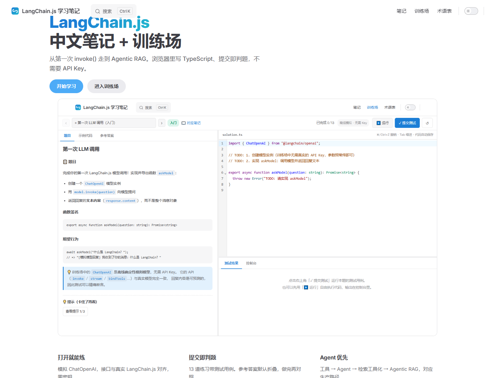
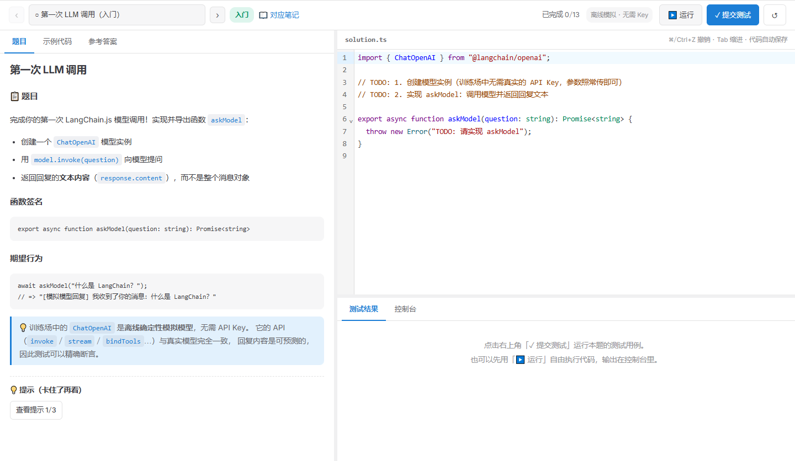

# LangChain.js 手册

从第一次 `invoke()` 走到 Agentic RAG。中文手册 + 浏览器内 LeetCode 式训练场，**不需要 API Key**。

<p align="center">
  
</p>

<p align="center">
  
  
  
  
</p>

## 在线阅读

推到 GitHub 并打开 Pages 后，站点地址是：

`https://<你的用户名>.github.io/langchainjs-handbook/`

本地：

```bash
npm install
npm run dev
```

打开 http://localhost:5173/

## 为什么做这份手册

[microsoft/langchainjs-for-beginners](https://github.com/microsoft/langchainjs-for-beginners) 课程质量很高，但对中文读者有两个摩擦点：**英文长文**、**必须先配模型密钥才能动手**。

这份仓库做了两件事：

1. **知识点导向的中文手册** —— 速览 → 核心代码 → 常见坑 → 动手练习，不是逐字翻译
2. **浏览器内训练场** —— 确定性模拟模型 + 真实 `@langchain/core` API，提交即判题

<p align="center">
  
</p>

## 你将学到什么

教学顺序是 **Agent 优先**：先工具、再 Agent，最后把检索封装成工具交给 Agent。

| 篇章 | 内容 | 训练场 |
|------|------|--------|
| 00 环境搭建 | Node、GitHub Models、`.env` | — |
| 01 初识 LangChain.js | 第一次 `invoke()`、三种消息类型 | 1 题 |
| 02 Chat 模型 | 多轮历史、流式、temperature、token | 2 题 |
| 03 提示词与结构化输出 | 模板、Few-shot、Zod | 3 题 |
| 04 函数调用与工具 | 模型只生成意图，执行在你的代码里 | 2 题 |
| 05 Agent | ReAct、`createAgent()` | 1 题 |
| 06 MCP | 把外部工具接到 Agent | 1 题 |
| 07 文档与语义搜索 | 分块、Embedding、余弦相似度 | 2 题 |
| 08 Agentic RAG | Agent 自主决定何时检索 | 1 题 |

## 训练场

- 左侧：题目 / 示例代码 / 参考答案
- 右侧：TypeScript 编辑器（自动保存在本地）
- 下方：测试结果 + `console.log`
- `ChatOpenAI` 是离线模拟模型，接口与真实模型对齐，所以测试可以精确断言

## 发布到 GitHub Pages

1. 把仓库推到 GitHub，仓库名建议为 `langchainjs-handbook`
2. Settings → Pages → Source 选 **GitHub Actions**
3. 推送 `main` 后，workflow 会跑 13 道练习测试并发布站点

如果仓库名不同，同时改 `docs/.vitepress/site.ts` 的 `REPO_NAME` 和 `.github/workflows/deploy.yml` 的 `VP_BASE`。

```bash
npm run test:exercises   # 校验练习参考答案
npm run build            # 静态构建
```

## 致谢

内容基于 [microsoft/langchainjs-for-beginners](https://github.com/microsoft/langchainjs-for-beginners)（MIT）提炼，**不是逐字翻译**。代码示例保留 LangChain.js v1 API。

本仓库同样以 MIT 协议发布。欢迎纠错，见 [CONTRIBUTING.md](CONTRIBUTING.md)。
